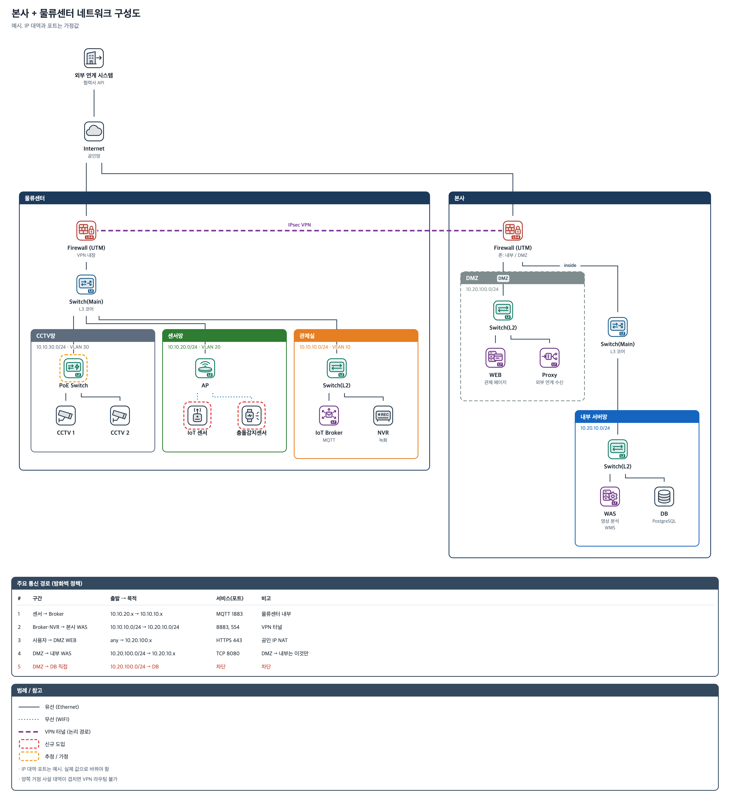

# network-diagram-skill

네트워크를 **말로 설명하면** 아이콘이 들어간 네트워크 구성도를 그려 주는 AI 스킬입니다. 비개발자가 용어를 몰라도 됩니다. 기존 구성도를 올리면 잘못된 곳(방화벽을 건너뛰는 선, 내부망에 바로 붙은 DMZ 등)을 찾아 고친 그림도 만들어 줍니다.

Claude, ChatGPT, Gemini, Grok, Codex 에서 쓸 수 있습니다.



## 어떻게 동작하나요

```
사용자: "본사랑 물류센터가 있고, 센터에 CCTV 10대랑 센서가 있어요. 본사엔 웹 서버랑 DB가 있고요."
   │
   ▼
AI: 몇 가지 묻고 → 구성도 명세(YAML) 작성 → 점검 체크리스트로 고침
   │
   ▼
렌더러: YAML → 자동 배치 → SVG / PNG
```

- 코드를 실행할 수 있는 AI(Claude Code, Codex, Gemini CLI, Claude.ai)는 그림 파일까지 바로 만듭니다.
- 웹 채팅(ChatGPT, Gemini, Grok)은 YAML 을 주고, 사용자가 **[웹 렌더러](https://java-jaydev.github.io/network-diagram-skill/)** 에 붙여 넣어 그림을 받습니다. 웹 렌더러는 브라우저 안에서만 동작하고 입력을 어디에도 보내지 않습니다.

## 설치

### Claude Code

```
/plugin marketplace add java-jaydev/network-diagram-skill
/plugin install network-diagram@network-diagram-skill
```

그다음 "우리 회사 네트워크 구성도 그려줘" 처럼 말하면 됩니다.

### Claude.ai (웹, 데스크톱 앱)

1. [Releases](https://github.com/java-jaydev/network-diagram-skill/releases) 에서 `network-diagram-skill.zip` 을 받습니다.
2. 설정 → 기능(Capabilities) → 스킬 → 스킬 업로드에서 zip 을 올립니다. (코드 실행 기능이 켜져 있어야 그림 파일까지 만듭니다.)

### Codex CLI

```bash
git clone https://github.com/java-jaydev/network-diagram-skill.git
mkdir -p ~/.codex/skills && cp -R network-diagram-skill/skills/network-diagram ~/.codex/skills/
```

### Gemini CLI

```bash
gemini extensions install https://github.com/java-jaydev/network-diagram-skill
```

### ChatGPT (GPT 만들기 또는 프로젝트)

1. **지침(Instructions)** 에 [`platforms/web-chat-instructions.md`](platforms/web-chat-instructions.md) 내용을 붙여 넣습니다.
2. **지식(Knowledge) / 파일** 에 [`spec.md`](skills/network-diagram/references/spec.md) 와 [`checklist.md`](skills/network-diagram/references/checklist.md) 를 올립니다.

### Gemini (Gem 만들기)

Gem 의 **안내(Instructions)** 에 [`platforms/web-chat-instructions.md`](platforms/web-chat-instructions.md) 를 붙여 넣고, **지식** 에 `spec.md`, `checklist.md` 를 추가합니다.

### Grok (프로젝트)

프로젝트를 만들고 **지침** 에 [`platforms/web-chat-instructions.md`](platforms/web-chat-instructions.md) 를, **파일** 에 `spec.md`, `checklist.md` 를 넣습니다. 프로젝트 기능이 없으면 대화 첫 메시지에 지침과 두 파일 내용을 붙여 넣어도 됩니다.

## 명세(YAML) 맛보기

```yaml
title: 작은 사무실
nodes:
  - { id: internet, type: internet, label: Internet }
zones:
  - id: office
    label: 사무실
    kind: site
    cidr: 192.168.0.0/24
    nodes:
      - { id: fw, type: firewall, label: 공유기 겸 방화벽 }
      - { id: sw, type: switch, label: 스위치 }
      - { id: pc, type: pc, label: 업무 PC }
links:
  - [internet, fw]
  - [fw, sw]
  - [sw, pc]
```

형식 전체와 장비 type 45종은 [`spec.md`](skills/network-diagram/references/spec.md), AI 가 그리기 전에 확인하는 항목은 [`checklist.md`](skills/network-diagram/references/checklist.md) 에 있습니다.

## 직접 실행 (Node 18 이상, 설치 불필요)

```bash
node skills/network-diagram/scripts/cli.mjs my-network.yaml -o my-network.svg --png my-network.png
```

`--png` 는 Chrome 또는 Chromium 이 있어야 합니다. 아이콘 스타일은 `--icons affinity` 로 바꿀 수 있습니다.

## 개발

```bash
npm install        # 빌드·테스트용 (elkjs, js-yaml 원본)
npm run build      # 아이콘 표 생성 + renderer/ 를 docs/lib, skills/.../scripts 로 복사
npm test
```

원본은 `renderer/`, `icons/`, `skills/network-diagram/references/` 입니다. `docs/lib/` 와 `skills/network-diagram/scripts/` 는 빌드 결과물이니 직접 고치지 마세요.

## 라이선스

- 이 저장소의 코드, 문서, 자체 아이콘(`icons/custom/`): [MIT](LICENSE)
- 함께 들어 있는 외부 자료: [THIRD_PARTY_NOTICES.md](THIRD_PARTY_NOTICES.md)
  - Affinity 아이콘: Unlicense (퍼블릭 도메인)
  - elkjs 0.9.3: Eclipse Public License 2.0
  - js-yaml 4.1.0: MIT
- Cisco 공식 아이콘은 재배포 조건이 명확하지 않아 포함하지 않았습니다.

---

## English

Describe a network in plain words and get an icon-based network diagram. The AI interviews you, writes a YAML spec, checks it against a review checklist (DMZ behind the firewall, inbound traffic through the firewall, Wi-Fi devices via an AP, non-overlapping site subnets), and renders SVG/PNG with automatic layout (ELK). Chat-only assistants hand you the YAML to paste into the [web renderer](https://java-jaydev.github.io/network-diagram-skill/), which runs entirely in your browser. MIT licensed; third-party notices in `THIRD_PARTY_NOTICES.md`.
